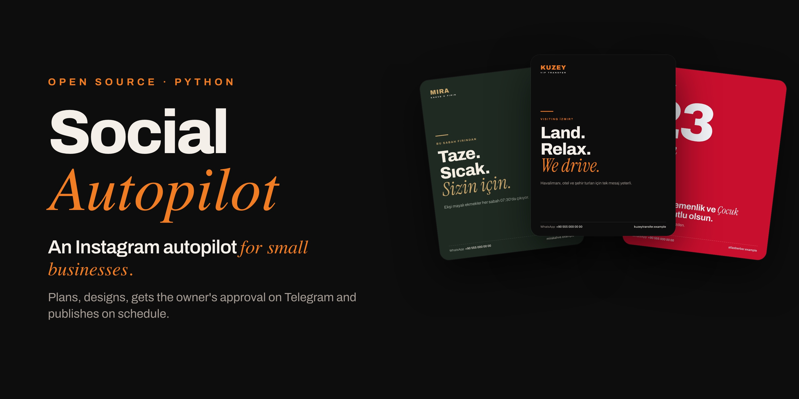
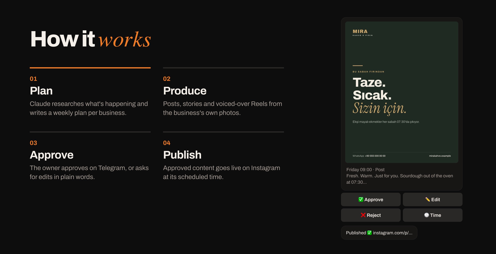
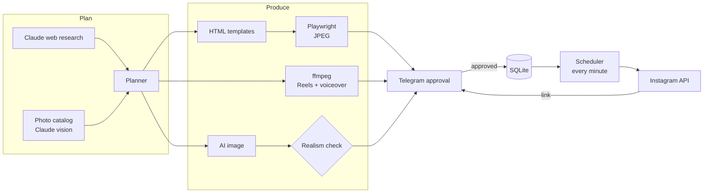

<div align="center">




**English** · [Türkçe](README.tr.md)

</div>

---

## What it does

Most small businesses know they should post on Instagram every week, but nobody has the time to plan, design and
publish. Social Autopilot does the whole loop for many businesses at once:

1. **Plans.** Every week or month, Claude researches what is happening (holidays, local events, seasons, trade
   fairs), looks at the business profile, its photo library and recent posts, and writes a content plan.
2. **Produces.** Each plan item becomes a finished post, story, carousel or Reel, made from the business's own
   photos with brand colors, fonts and logo.
3. **Asks.** The business owner gets every item on Telegram with **Approve · Edit · Reject · Reschedule** buttons.
   An edit request in plain language ("make the title shorter, use the night photo") regenerates the item.
4. **Publishes.** Approved items go to Instagram at their scheduled time, and the owner gets the link.

The owner only sends photos and taps buttons. The admin manages every business from one Telegram bot.



## Sample output

The same templates, rendered for three different brands. Colors, logo and language come from each business
profile. The brands below are fictional.


## Features

**Content**
- AI content planning with web research and structured (Pydantic-validated) output
- Variety rules: template and tone usage is tracked so the same combination is not repeated within two weeks
- Free-text requests: *"tomorrow 21:00 story about airport pickup"* is parsed into a scheduled item
- Vision photo catalog: Claude describes every photo, scores its quality and picks the crop focus point

**Rendering**
- Jinja2 HTML templates rendered by headless Chromium (Playwright) at 1080×1350 and 1080×1920
- Vertical Reels with ffmpeg: cuts on the music beat, text overlays, AI voiceover (ElevenLabs, OpenAI fallback)
- Per-business design system: each business can get its own AI-generated template set
- Realism guardrails: products, vehicles and venues always come from real photos. AI images are only used for
  atmosphere, and each one is scored by Claude. Low scores are regenerated or replaced with stock photos

**Publishing**
- Instagram API with Instagram Login: two-step publishing, container status polling and rate-limit checks
- One-link OAuth onboarding and automatic long-lived token refresh
- Manual-share fallback: if Instagram is not connected, the owner gets the media and a ready caption on time

**Business operations**
- Admin bot plus a separate bot for each business
- Packages with weekly quotas, monthly revisions and credits, free trial, subscriptions and grace period
- Per-business AI cost tracking, provider balance tracking and low-balance alerts
- Automatic onboarding: a business profile (services, colors, logo, hashtags) is built from a website or Instagram
- Sales bot: a visitor sends their website and gets a free sample post. Duplicate and abuse limits apply

## Architecture



A single Python process runs every Telegram bot and the scheduler. Caddy serves the media over HTTPS, because
Instagram downloads images from a public URL.

## Tech stack

| Area | Tools |
|---|---|
| Language & tooling | Python 3.12, uv, Ruff, pytest |
| AI | Anthropic Claude (planning, research, vision, quality checks), OpenAI (images, TTS), ElevenLabs (voiceover) |
| Rendering | Jinja2 (sandboxed), Playwright / Chromium, Pillow, NumPy, ffmpeg |
| Bots & jobs | python-telegram-bot, APScheduler, aiohttp |
| Data | SQLite, YAML business profiles, Pydantic |
| Integrations | Instagram API, Unsplash, Pexels, Pixabay |
| Deployment | Linux VPS, hardened systemd unit, Caddy (automatic HTTPS), cron backups |

## Security

- **AI-written templates are sandboxed.** They render in a Jinja2 `SandboxedEnvironment` and are scanned before use
  for scripts, event handlers, external resources, `file://` links and unsafe Jinja constructs
  ([`app/htmlsafe.py`](app/htmlsafe.py)). Uploaded SVG logos are scanned the same way.
- **SSRF protection** for every outside URL ([`app/netsafe.py`](app/netsafe.py)): non-public addresses are blocked,
  every redirect is checked again, and download size and time are limited.
- **Secrets stay out of the code.** Keys live in `.env` or the database. Tokens sent through Telegram are deleted
  from the chat right after they are read, and backups are only readable by their owner.
- **Least privilege.** The systemd unit is hardened, and only the configured admin can run management commands.
- A dedicated test suite covers template injection, path traversal, SSRF and permission checks.

## Getting started

**Requirements:** Python 3.12, [uv](https://docs.astral.sh/uv/), ffmpeg, a Telegram bot token, an Anthropic API key.
OpenAI, ElevenLabs and the stock photo APIs are optional.

```bash
git clone https://github.com/OmerP14/social-autopilot.git
cd social-autopilot
uv sync
uv run playwright install chromium
cp .env.example .env          # add your keys
uv run python -m app.bot      # starts the bots and the scheduler
```

Open your admin bot on Telegram, send `/menu` and add a business with **➕ New business**. Its profile is created
from the website under `clients/<slug>/client.yaml`. The full onboarding guide, including the Meta app setup, is in
[docs/YENI_FIRMA.md](docs/YENI_FIRMA.md) (Turkish).

To publish to Instagram, the media folder must be reachable over HTTPS. The `deploy/` folder has a systemd unit, a
Caddyfile, and sync and backup scripts for a small VPS.

<details>
<summary>Command-line tools</summary>

```bash
uv run python -m app.planner --client <slug> --week          # plan next week
uv run python -m app.produce --client <slug> --month 2026-11 # render a month's plan
uv run python -m app.catalog --client <slug>                 # catalog new photos
uv run python -m app.stock   --client <slug>                 # download stock photos
```
</details>

## Tests

```bash
uv run --with pytest pytest -q
uv run ruff check app tests
```

There are 98 tests. They use no network and make no paid API calls: any accidental call to a real AI API fails
the test. They run against a temporary database, a fictional test business and a fake Telegram layer. Besides unit
and security tests, the suite has **end-to-end bot conversations**: welcome → trial → menu → custom request →
package change → trial end → payment → monthly renewal → extra credits.

## Project structure

```
app/
├── bot.py         Telegram bots and scheduled jobs (publishing, planning, billing, alerts)
├── planner.py     Content planning with Claude
├── produce.py     Plan item → image / carousel / video, regeneration from feedback
├── renderer.py    HTML template → image
├── video.py       Reels: photos and clips, music, text, voiceover
├── design.py      Per-business design system
├── catalog.py     Vision-based photo catalog
├── genai.py       AI images and voiceover
├── realism.py     Realism scoring for AI output
├── instagram.py   Publishing and token refresh
├── igoauth.py     One-link Instagram connection (OAuth)
├── billing.py     Packages, quotas, credits, subscriptions
├── wallet.py      Provider balances and cost report
├── onboard.py     Business profile from a website or Instagram
├── sales.py       Sales bot and free sample posts
├── htmlsafe.py    Template and SVG security scan
├── netsafe.py     SSRF-safe downloads
└── when.py        Turkish date parsing ("yarın 20:00", "cuma 21:00")
templates/         Default post, story, carousel and video templates
config/            Packages and pricing
deploy/            systemd, Caddy, sync and backup scripts
tests/             Unit, security and end-to-end tests
```

> The Telegram interface and the AI prompts are in Turkish. The content itself can be in any language that is set
> per business (for example, English headlines with Turkish captions).

## License

[MIT](LICENSE) © Ömer Pehriz
