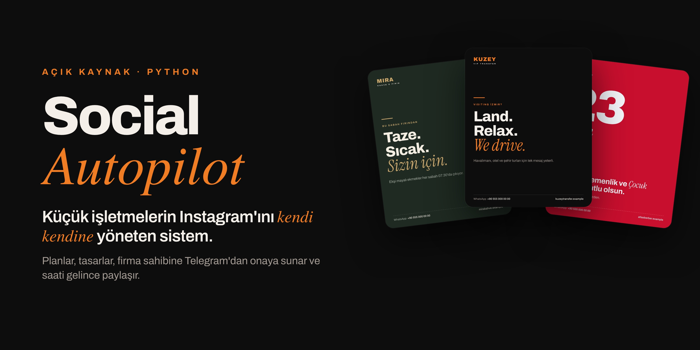
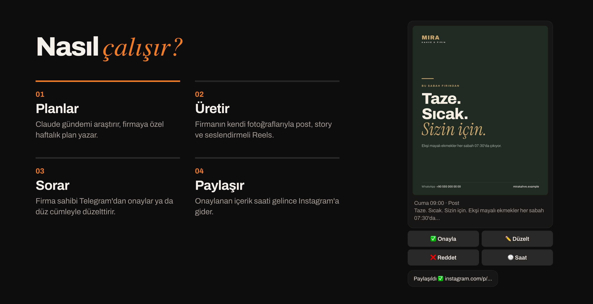
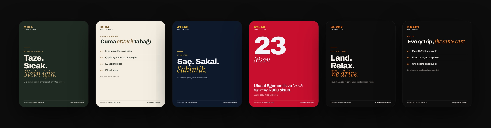
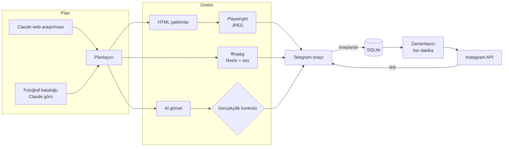

<div align="center">




[English](README.md) · **Türkçe**

</div>

---

## Ne yapar?

Küçük işletmelerin çoğu Instagram'da her hafta paylaşım yapması gerektiğini bilir, ama planlamaya, tasarlamaya ve
paylaşmaya kimsenin vakti yoktur. Social Autopilot bu döngünün tamamını aynı anda birçok firma için yürütür:

1. **Planlar.** Her hafta ya da ay Claude gündemi araştırır (bayramlar, şehirdeki etkinlikler, sezon, fuarlar);
   firma profiline, fotoğraf arşivine ve son paylaşımlara bakıp içerik planını yazar.
2. **Üretir.** Plandaki her madde, firmanın kendi fotoğraflarıyla, marka renkleri, yazı tipleri ve logosuyla
   hazırlanmış bir post, story, carousel ya da Reels'e dönüşür.
3. **Sorar.** Firma sahibi her içeriği Telegram'da **Onayla · Düzelt · Reddet · Saat** butonlarıyla görür.
   Düzeltme isteği düz cümleyle yazılır ("başlığı kısalt, gece fotoğrafını kullan") ve içerik yeniden üretilir.
4. **Paylaşır.** Onaylanan içerikler saati gelince Instagram'a gider, firma sahibine paylaşım linki gelir.

Firma sahibi sadece fotoğraf gönderir ve butonlara dokunur. Yönetici bütün firmaları tek bir Telegram botundan yönetir.



## Örnek çıktılar

Aynı şablonlar, üç farklı marka için üretildi. Renkler, logo ve dil her firmanın profilinden gelir. Aşağıdaki
markalar hayalidir.



## Özellikler

**İçerik**
- Web araştırmalı yapay zekâ planlaması, yapılandırılmış (Pydantic ile doğrulanan) çıktı
- Çeşitlilik kuralları: şablon ve ton kullanımı takip edilir, aynı kombinasyon iki hafta içinde tekrarlanmaz
- Serbest metinle istek: *"yarın 21:00 havalimanı karşılama story'si"* yazmak, zamanlanmış bir içerik oluşturur
- Görüntü tanımalı fotoğraf kataloğu: Claude her fotoğrafı tanımlar, kalitesini puanlar, kırpma noktasını seçer

**Görsel ve video üretimi**
- Jinja2 HTML şablonları, Playwright (Chromium) ile 1080×1350 ve 1080×1920 boyutunda görsele dönüşür
- ffmpeg ile dikey Reels: müziğin ritmine göre kesme, yazı katmanları, yapay zekâ seslendirmesi (ElevenLabs, yedek
  olarak OpenAI)
- Firmaya özel tasarım: her firma yapay zekânın hazırladığı kendine ait şablon setine sahip olabilir
- Gerçekçilik kuralları: ürün, araç ve mekân hep gerçek fotoğraflardan gelir. Yapay zekâ görseli sadece atmosfer
  için kullanılır ve her birini Claude puanlar. Puanı düşük olan yeniden üretilir ya da yerine stok fotoğraf konur

**Paylaşım**
- Instagram API with Instagram Login: iki adımlı paylaşım, container durum takibi, paylaşım limiti kontrolü
- Instagram'ı tek linkle bağlama (OAuth) ve uzun ömürlü token'ın otomatik yenilenmesi
- Instagram bağlı değilse, içerik ve hazır açıklama saatinde firma sahibine elle paylaşım için gönderilir

**İşletme tarafı**
- Yönetim botu ve her firmaya ayrı bir bot
- Haftalık içerik hakkı olan paketler, aylık revize ve kredi hakları, ücretsiz deneme, abonelik ve ek süre
- Firma başına yapay zekâ maliyeti, sağlayıcı bakiyesi takibi ve düşük bakiye uyarıları
- Otomatik firma kurulumu: web sitesinden ya da Instagram'dan firma profili (hizmetler, renkler, logo, hashtag'ler)
- Satış botu: ziyaretçi sitesini yazar, ücretsiz örnek post alır. Mükerrer ve kötüye kullanım sınırları vardır

## Mimari



Tüm Telegram botları ve zamanlayıcı tek bir Python sürecinde çalışır. Instagram görselleri herkese açık bir
adresten indirdiği için medya, Caddy ile HTTPS üzerinden sunulur.

## Teknolojiler

| Alan | Araçlar |
|---|---|
| Dil ve araçlar | Python 3.12, uv, Ruff, pytest |
| Yapay zekâ | Anthropic Claude (plan, araştırma, görü, kalite kontrolü), OpenAI (görsel, ses), ElevenLabs (seslendirme) |
| Üretim | Jinja2 (sandbox), Playwright / Chromium, Pillow, NumPy, ffmpeg |
| Botlar ve işler | python-telegram-bot, APScheduler, aiohttp |
| Veri | SQLite, YAML firma profilleri, Pydantic |
| Entegrasyonlar | Instagram API, Unsplash, Pexels, Pixabay |
| Kurulum | Linux VPS, sertleştirilmiş systemd servisi, Caddy (otomatik HTTPS), cron yedekleri |

## Güvenlik

- **Yapay zekânın yazdığı şablonlar sandbox'ta çalışır.** Jinja2 `SandboxedEnvironment` içinde işlenirler ve
  kullanılmadan önce script, olay öznitelikleri, dış kaynaklar, `file://` bağlantıları ve tehlikeli Jinja yapıları
  için taranırlar ([`app/htmlsafe.py`](app/htmlsafe.py)). Yüklenen SVG logolar da aynı taramadan geçer.
- **SSRF koruması** ([`app/netsafe.py`](app/netsafe.py)): dışarıdan gelen her adreste herkese açık olmayan IP'ler
  engellenir, her yönlendirme yeniden kontrol edilir, indirme boyutu ve süresi sınırlıdır.
- **Anahtarlar kodda değildir.** `.env` dosyasında ya da veritabanında durur. Telegram'dan gönderilen token'lar
  okunur okunmaz sohbetten silinir, yedekleri sadece sahibi okuyabilir.
- **En az yetki.** systemd servisi sertleştirilmiştir, yönetim komutlarını sadece tanımlı yönetici çalıştırabilir.
- Şablon enjeksiyonu, dizin aşımı (path traversal), SSRF ve yetki kontrolleri için ayrı testler vardır.

## Kurulum

**Gerekenler:** Python 3.12, [uv](https://docs.astral.sh/uv/), ffmpeg, Telegram bot token'ı, Anthropic API anahtarı.
OpenAI, ElevenLabs ve stok fotoğraf API'leri isteğe bağlıdır.

```bash
git clone https://github.com/OmerP14/social-autopilot.git
cd social-autopilot
uv sync
uv run playwright install chromium
cp .env.example .env          # anahtarlarını yaz
uv run python -m app.bot      # botları ve zamanlayıcıyı başlatır
```

Telegram'da yönetim botunu açıp `/menu` yaz ve **➕ Yeni firma** ile firma ekle. Firma profili web sitesinden
çıkarılır ve `clients/<kısa-ad>/client.yaml` olarak kaydedilir. Meta uygulaması kurulumu dahil adım adım rehber:
[docs/YENI_FIRMA.md](docs/YENI_FIRMA.md).

Instagram'a paylaşım için medya klasörünün HTTPS ile erişilebilir olması gerekir. `deploy/` klasöründe küçük bir
VPS için systemd servisi, Caddyfile, gönderim ve yedek betikleri var.

<details>
<summary>Komut satırı araçları</summary>

```bash
uv run python -m app.planner --client <kısa-ad> --week          # gelecek haftayı planla
uv run python -m app.produce --client <kısa-ad> --month 2026-11 # ayın planını üret
uv run python -m app.catalog --client <kısa-ad>                 # yeni fotoğrafları katalogla
uv run python -m app.stock   --client <kısa-ad>                 # stok fotoğraf indir
```
</details>

## Testler

```bash
uv run --with pytest pytest -q
uv run ruff check app tests
```

98 test var. Ağa çıkmazlar ve ücretli API çağrısı yapmazlar: yanlışlıkla gerçek bir yapay zekâ API'si çağrılırsa
test başarısız olur. Geçici bir veritabanı, kurgusal bir test firması ve sahte bir Telegram katmanıyla çalışırlar.
Birim ve güvenlik testlerinin yanında **uçtan uca bot konuşmaları** da test edilir: karşılama → deneme → menü →
özel istek → paket değişikliği → deneme bitişi → ödeme → ay sonu yenileme → ek kredi.

## Proje yapısı

```
app/
├── bot.py         Telegram botları ve zamanlanmış işler (paylaşım, plan, abonelik, uyarılar)
├── planner.py     Claude ile içerik planı
├── produce.py     Plan maddesi → görsel / carousel / video, geri bildirimle yeniden üretim
├── renderer.py    HTML şablon → görsel
├── video.py       Reels: fotoğraf ve klipler, müzik, yazı, seslendirme
├── design.py      Firmaya özel tasarım
├── catalog.py     Görüntü tanımalı fotoğraf kataloğu
├── genai.py       Yapay zekâ görseli ve seslendirme
├── realism.py     Yapay zekâ çıktısı için gerçekçilik puanı
├── instagram.py   Paylaşım ve token yenileme
├── igoauth.py     Instagram'ı tek linkle bağlama (OAuth)
├── billing.py     Paketler, haklar, kredi, abonelik
├── wallet.py      Sağlayıcı bakiyeleri ve maliyet raporu
├── onboard.py     Web sitesinden ya da Instagram'dan firma profili
├── sales.py       Satış botu ve ücretsiz örnek post
├── htmlsafe.py    Şablon ve SVG güvenlik taraması
├── netsafe.py     SSRF'e karşı güvenli indirme
└── when.py        Türkçe tarih çözümleme ("yarın 20:00", "cuma 21:00")
templates/         Varsayılan post, story, carousel ve video şablonları
config/            Paketler ve fiyatlar
deploy/            systemd, Caddy, gönderim ve yedek betikleri
tests/             Birim, güvenlik ve uçtan uca testler
```

> Telegram arayüzü ve yapay zekâ istemleri Türkçedir. İçeriğin dili ise firma bazında ayarlanır (örneğin İngilizce
> başlık ve Türkçe açıklama).

## Lisans

[MIT](LICENSE) © Ömer Pehriz
